# THE FORGOTTEN FOREST — MASTER UPGRADE PLAN (v2.2)

**Target Specification:** `The_Forgotten_Forest_Complete_Experience_Bible.md`  
**Execution Strategy:** Continuous Autonomous Upgrade in Place  
**Baseline:** v2.1.0-onboarding-overhaul (Place Version 18)  
**Date:** 2026-11-16  

---

## 1. Task Breakdown & Dependency Graph

```mermaid
flowchart TD
    subgraph Bible Upgrades
        H1["1. Lore & 5 Keeper Seals<br/>Elias Venn & Mira Vale"] --> H2["2. Items & Recipes<br/>Lantern, Barricade, Trap"]
        H2 --> H3["3. Status Effects Framework<br/>Cold, Bleed, Exhaustion"]
        
        I1["4. 3D Procedural Assets<br/>Beacon, Watchtower, Split Oak"] --> I2["5. Village Architecture<br/>Clock Tower, Archive, Dry Fountain"]
        I2 --> I3["6. Custom Flora Families<br/>Pines, Oaks, Reeds, Shrines"]

        J1["7. World Interaction Service<br/>Beacon States: Repair to Active"] --> J2["8. Three Lantern Archive Puzzle<br/>Root to Ember to Echo"]
        J2 --> J3["9. Watchtower Telescope<br/>Landmark Discovery"]
        J3 --> J4["10. Clock Tower Repair<br/>Gear Restoration"]

        K1["11. Master QA Suite v2.2<br/>10/10 Gate Pass"] --> K2["12. Roblox Cloud Save<br/>Place Persistence"]
        K2 --> K3["13. Git Tag & Documentation<br/>v2.2.0-experience-bible"]
    end

    H1 --> I1
    H2 --> J1
    I3 --> J1
    J4 --> K1
```

---

## 2. Phase-by-Phase Execution Details

### Phase 1: Narrative Lore, Seals & Expanded Data Catalogs
- Update [StoryDefinitions.lua](file:///d:/Projects/forgotten%20forest/src/ReplicatedStorage/TFF/Shared/Definitions/StoryDefinitions.lua):
  - Expand dialogue trees for Alden (`cartographer`), Mara (`medic`), and The Old Keeper (`old_keeper`) reflecting the truth of Elderglen, the Heartroot underground intelligence, Elias Venn's fatal experiment, Mira Vale's sealed records, and the 5 Keepers' Seals:
    1. **Root Seal:** Regulates subterranean root stability.
    2. **Veil Seal:** Defines boundaries between reality and shifting paths.
    3. **Echo Seal:** Preserves and repeats sounds and memories.
    4. **Ember Seal:** Maintains warmth and safe camp paths.
    5. **Heart Seal:** Central equilibrium of the living Heartroot.
  - Add transcripts for the 3 Archive Clues, Mira Vale's Expedition Journal, and the Clock Tower Maintenance Note.
- Update [ItemDefinitions.lua](file:///d:/Projects/forgotten%20forest/src/ReplicatedStorage/TFF/Shared/Definitions/ItemDefinitions.lua):
  - Add `advanced_lantern` (crystal-shielded high illumination).
  - Add `wooden_barricade` (deployable defensive timber obstacle).
  - Add `basic_trap` (wooden spring-loaded snare).
  - Add `clock_gear` (brass gear for clock tower restoration).
  - Add `archive_key_fragment` (three pieces unlocking the village archive).
- Update [RecipeDefinitions.lua](file:///d:/Projects/forgotten%20forest/src/ReplicatedStorage/TFF/Shared/Definitions/RecipeDefinitions.lua):
  - Add crafting recipes for `advanced_lantern` (2 crystals + 3 metal scrap).
  - Add crafting recipe for `wooden_barricade` (5 wood).
  - Add crafting recipe for `basic_trap` (3 wood + 2 rope).
- Update [QuestDefinitions.lua](file:///d:/Projects/forgotten%20forest/src/ReplicatedStorage/TFF/Shared/Definitions/QuestDefinitions.lua):
  - Align quest chains with the 5 chapters from the Experience Bible:
    - **Prologue:** A Light in the Valley (Reach camp, meet Alden, gather supplies, repair beacon).
    - **Chapter 1:** Footsteps in the Moss (Split Oak landmark, scout camp, scout journal, activate shrine).
    - **Chapter 2:** The Village That Stopped (Cross bridge, inspect clock tower, find 3 clues, solve Three Lantern Puzzle, open archive).
    - **Chapter 3:** The Broken Root (Locate damaged Root Seal, repair mechanisms, activate seal).
    - **Chapter 4:** The Voice Below (Mine entrance, Crystal Caverns, Keeper device, reach Ancient Grounds).

### Phase 2: Procedural 3D Low-Poly Asset Generator
- Author [tools/build_experience_bible_assets.lua](file:///d:/Projects/forgotten%20forest/tools/build_experience_bible_assets.lua) to construct custom 3D low-poly models in the DataModel:
  - **Safe Haven:**
    - `SafeHaven_CentralBeacon`: Stone base, iron cage, dark glass core, and amber light emitters supporting multi-state transitions (`Damaged` vs `Active`).
    - `SafeHaven_Watchtower`: 30-stud timber watchtower with stepped access, observation platform, and mounted brass telescope.
    - `SafeHaven_ArtisanWorkshop`: Blacksmith anvil, tool rack, and quenching trough.
    - `SafeHaven_TraderStall`: Wooden market booth with tiered shelves, ledger book, and clay pots.
  - **Whispering Woods:**
    - `Tree_SplitOak_Landmark`: 46-stud lightning-split oak tree with asymmetric foliage (one half charred timber, one half living mossy canopy with glowing roots), internal Keeper glyph carving, and supply cache.
    - `Bridge_Ravine_Timber`: 40-stud timber trestle bridge spanning the ravine with repair interaction prompt.
    - `SilentPond_Reeds`: Perimeter reed clusters and still water mirror.
    - `Shrine_KeeperTriPillar`: Stone circular dais with 3 triangular rune pillars.
  - **Abandoned Village:**
    - `Village_ClockTower_48`: 48-stud stone tower with stopped clock face, belfry, and interactable gear mechanism.
    - `Village_KeeperArchive`: Sealed stone vault portal with Three Puzzle Lanterns (Root, Ember, Echo).
    - `Village_DryFountain`: Hexagonal dry stone fountain with 5-Seal engraved floor medallion.
    - `Village_SecretWell`: Stone well with descending undercroft ladder.
  - **Custom Low-Poly Tree Families & Foliage:**
    - Tall straight pines, broad ancient oaks, hollow logs, twisted supernatural pines.

### Phase 3: World Interaction & Puzzle Services
- Create [WorldInteractionService.lua](file:///d:/Projects/forgotten%20forest/src/ServerScriptService/TFFServer/Services/WorldInteractionService.lua):
  - **Beacon Repair & Activation:** Handles player interaction on `SafeHaven_CentralBeacon`. When repaired with 4 wood and 2 stone, transitions state to `Active`, ignites the beacon core, plays an amber light pulse, updates `Lighting`, and broadcasts map sector revelation.
  - **Three Lantern Archive Puzzle:** Validates client interaction on the three archive lanterns. Enforces the canonical order (`Root -> Ember -> Echo`). On correct sequence, plays an unlatching sound and smoothly opens the archive vault doors.
  - **Clock Tower Repair:** Handles gear insertion on the stopped clock mechanism using `clock_gear`, triggering clock chime and advancing village quest progress.
  - **Watchtower Telescope:** Handles client interaction on the watchtower telescope, broadcasting landmark discoveries (Split Oak, Village Clock Tower, Watcher's Bluff) to the player's survey map.
- Integrate into [Bootstrap.server.lua](file:///d:/Projects/forgotten%20forest/src/ServerScriptService/TFFServer/Bootstrap.server.lua).

### Phase 4: Automated Verification & Cloud Release
- Update [tests/test_master_suite.lua](file:///d:/Projects/forgotten%20forest/tests/test_master_suite.lua) to include automated validation gates for:
  - Central Beacon repairable states.
  - Watchtower & Telescope placement.
  - Split Oak Landmark & Ravine Bridge.
  - Clock Tower & Three Lantern Archive Puzzle.
  - New weapon and utility tool templates (`advanced_lantern`, `wooden_barricade`, `basic_trap`).
  - Chapter quests and lore consistency.
- Save place to Roblox Cloud and commit to Git tagged `v2.2.0-experience-bible`.
